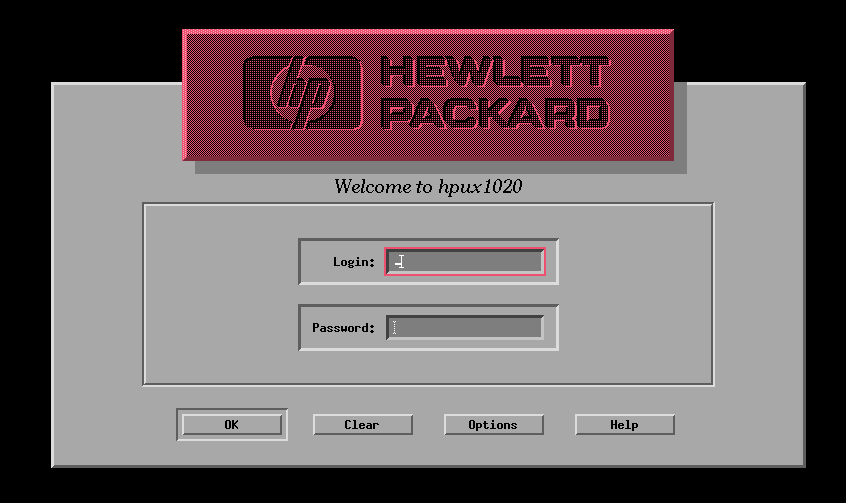

# lightdm-hpux-cde
LightDM webkit2 greeter theme HP UX CDE

HP-UX CDE inspired theme for lightdm-webkit2-greeter

Install the hpux-cde directory into /usr/share/lightdm-webkit/themes/.
In your existing /etc/lightdm/lightdm-webkit2-greeter.conf, change the
existing theme setting to hpux-cde. Preserve its key spelling as used
by your installed build (webkit_theme or webkit-theme).
Do not replace the entire system configuration.

The greeter-session setting in LightDM must select lightdm-webkit2-greeter.
No session selector is displayed. The default desktop session must already
be configured and working. The theme calls start_session_sync() without
an explicit session key.

Opening index.html in a browser previews the appearance only.
Real authentication requires the greeter environment.
Save your work before logging out or restarting the display manager.

This project has not been tested in a running LightDM session.
The SVG derives from the user-supplied Hewlett-Packard logo.
No ownership of the Hewlett-Packard trademark is claimed.

